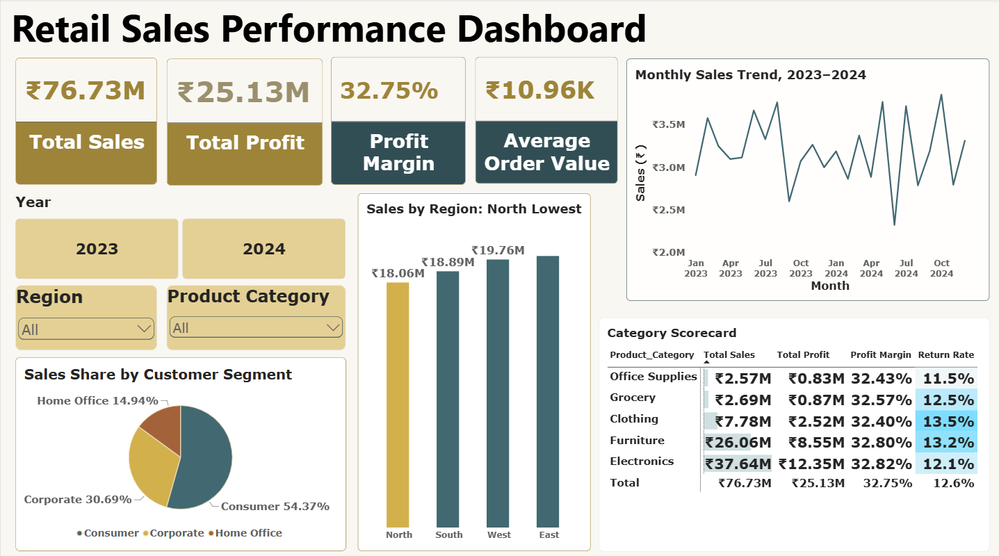

# Retail Sales Data Visualization

**Turning two years of retail transactions into a visual story that a manager can understand at a glance.**



🔗 **Live dashboard:** https://retail-sales-data-visualization.streamlit.app/

*Power BI dashboard: 4 KPIs, 3 filters (Year, Region, Product Category), monthly trend, regional comparison, customer segment share and a category scorecard.*

---

## About the project

This is a data visualization project built on a simulated retail company's customer and sales transactions (2023–2024) across four regions of India. I cleaned the data, explored it in Python with 13 purpose-chosen charts, and then built an interactive Power BI dashboard so the same story can be explored by filter.

The goal was not to make many charts. It was to pick the *right* chart for each business question: trends as lines, comparisons as bars, spread as box plots, relationships as scatter plots, and shares as donuts.

## Problem statement

The sales and marketing leadership of a retail company don't have time to read spreadsheets or statistical tables. They need to see patterns, comparisons and trends at a glance. The challenge was to turn raw retail transaction data into a compact, professional visual report that a regional manager could open and immediately understand:

- Where are sales strong?
- Where is profit coming from, or being lost?
- Who are the customers?
- What drives satisfaction and returns?

## Dataset

| | |
|---|---|
| **Records** | 7,000 transactions (after cleaning) |
| **Period** | January 2023 – December 2024 |
| **Columns** | 24 (customer, product, region, pricing, discount, sales, profit, rating, returns) |
| **Regions** | North, South, East, West |
| **Categories** | Electronics, Furniture, Clothing, Grocery, Office Supplies |
| **Note** | The dataset is simulated and deliberately messy. It contains no real customer data |

## What I did

1. **Cleaned the data.** Removed duplicates, standardized labels, repaired mixed date formats and handled impossible values (details below).
2. **Verified the cleaning** in Python: shape, data types, missing values, duplicates, date range and delivery-date logic.
3. **Prepared fields** for time analysis (Year, Month, Year-Month) and calculated the core KPIs.
4. **Built 13 charts** covering every required chart type, saved as high-resolution images.
5. **Built a Power BI dashboard** with KPIs, filters and linked visuals, using DAX measures for Total Sales, Total Profit, Profit Margin, Average Order Value and Return Rate.
6. **Validated the numbers** by checking dashboard KPIs against the Python results.

## Data cleaning

| Issue found | Fix |
|---|---|
| Duplicate records and repeated Transaction IDs (7,084 rows) | Removed, leaving 7,000 unique transactions |
| Region labels with 12 spelling variants | Standardized to North / South / East / West |
| Gender labels with 8 variants | Standardized to Male / Female |
| Order and Delivery dates in mixed formats | Parsed into real dates |
| Day and month swapped on ambiguous dates | Detected through impossible delivery gaps (negative or very long) and corrected |
| Impossible Age values (negative, 150, 999) | Set to blank |
| Impossible Discount values (below 0 or above 0.5) | Set to blank |
| Genuine missing values (rating, satisfaction, income, delivery date) | Left blank instead of filling with made-up numbers |

## Key findings

- **Overall performance:** ₹76.73M in sales and ₹25.13M in profit, a **32.75% profit margin**, with an average order value of about ₹10.96K.
- **Electronics leads.** It brings in about **49%** of sales, followed by Furniture at **34%**. Clothing, Grocery and Office Supplies together make up under 17%.
- **Profit margins are nearly identical across categories** (about 32.4% to 32.8%), so the category mix, not margin, drives total profit.
- **Regions are close.** East is the strongest (₹20.0M) and North the weakest (₹18.1M), a gap of roughly 10%.
- **Customers:** Consumers account for **54%** of sales, Corporate 31% and Home Office 15%.
- **Returns and satisfaction:** About **12.6%** of orders are returned (11.5% to 13.5% by category). Among rated orders, 37% report High satisfaction and 26% report Low.
- **Trend:** Monthly sales move between roughly ₹2.3M and ₹3.9M, with no sharp seasonal swing.

## Power BI dashboard

File: [`Retail_Sales_Dashboard.pbix`](Retail_Sales_Dashboard.pbix) (open in Power BI Desktop)

| Element | Details |
|---|---|
| **KPIs** | Total Sales, Total Profit, Profit Margin, Average Order Value |
| **Filters** | Year, Region, Product Category |
| **Visuals** | Monthly sales trend, sales by region (weakest region highlighted), sales share by customer segment, category scorecard (sales, profit, margin, return rate) |

## Charts built in Python

| # | Chart | Type | Question it answers |
|---|---|---|---|
| 1 | Monthly sales trend | Line | How have sales changed over time? |
| 2 | Sales by region | Bar | Which regions sell the most? |
| 3 | Sales by product category | Bar | Which categories drive revenue? |
| 4 | Customer age distribution | Histogram | Who are our customers? |
| 5 | Customer income distribution | Histogram | How is income spread, and is it skewed? |
| 6 | Sales share by customer segment | Donut | What share does each segment contribute? |
| 7 | Sales distribution by category | Box plot | How much do order sizes vary, and where are outliers? |
| 8 | Sales vs profit | Scatter | Do bigger sales mean bigger profit? |
| 9 | Discount vs profit | Scatter | Do discounts reduce profit? |
| 10 | Correlation of numerical variables | Heatmap | Which variables move together? |
| 11 | Average sales by category and region | Heatmap | Which category-region pairs perform best? |
| 12 | Customer satisfaction levels | Bar | How satisfied are customers? |
| 13 | Product return status | Bar | How often are products returned? |

All chart images are in the [`visualizations/`](visualizations/) folder.

## Tools used

- **Python:** pandas, NumPy, Matplotlib, Seaborn, Plotly
- **Power BI Desktop:** data modelling, DAX measures, interactive dashboard
- **Excel:** data cleaning and checks
- **Jupyter Notebook:** analysis and chart generation

## Repository structure

```
├── README.md
├── Retail_Sales_Analysis.ipynb       # data checks and all 13 charts
├── Retail_Sales_Dashboard.pbix       # Power BI dashboard
├── data/                             # raw and cleaned datasets
├── visualizations/                   # chart images exported by the notebook
└── images/                           # dashboard screenshot
```

## How to run

1. Clone the repository:
   ```
   git clone https://github.com/eshasharma-ai/retail-sales-data-visualization.git
   ```
2. Install the libraries:
   ```
   pip install pandas numpy matplotlib seaborn plotly openpyxl
   ```
3. Open `Retail_Sales_Analysis.ipynb` in Jupyter and choose **Kernel → Restart & Run All**.

The notebook reads `data/Cleaned_retail_customer_sales_dataset.xlsx` and saves its charts to `visualizations/`.

## About me

**Esha Sharma**, MCA student building toward a career in AI Product Management and Data Analytics.

- GitHub: [github.com/eshasharma-ai](https://github.com/eshasharma-ai)
- LinkedIn: [linkedin.com/in/eshasharma-ai](https://www.linkedin.com/in/eshasharma-ai)
